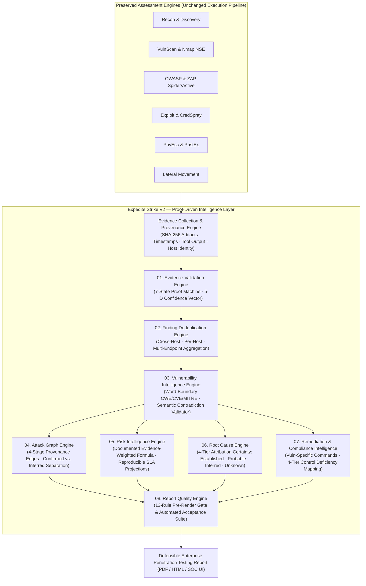

# EXPEDITE STRIKE V2 — Finding & Evidence Intelligence Specification

> [!IMPORTANT]
> **Architectural Principle**: Preserve all existing discovery, scanning, OWASP, exploitation, privilege-escalation, post-exploitation, and lateral-movement engines. Insert an eight-component **Proof-Driven Intelligence & Quality Layer** between raw engine telemetry and enterprise deliverables (PDF, HTML, and Live SOC Dashboard).

---

## 1. Eight-Component Intelligence Architecture



---

## 2. Database Schema (SQLite / PostgreSQL DDL)

The V2 intelligence layer persists normalized findings, raw provenance artifacts, endpoint occurrences, attack-graph edges, and quality-gate audit logs using five relational tables:

```sql
-- 1. Reconciled Assets & Scope Inventory
CREATE TABLE IF NOT EXISTS v2_assets (
    asset_id                  TEXT PRIMARY KEY,
    ip_address                TEXT NOT NULL UNIQUE,
    hostname                  TEXT,
    mac_address               TEXT,
    vendor                    TEXT,
    verified_os               TEXT NOT NULL,
    inventory_state           TEXT NOT NULL CHECK (inventory_state IN (
                                  'RESPONSIVE_ASSESSED', 'DISCOVERED_IDLE',
                                  'UNRESPONSIVE_IN_SCOPE', 'EXCLUDED'
                              )),
    host_role                 TEXT NOT NULL,
    app_role                  TEXT NOT NULL,
    criticality               TEXT NOT NULL CHECK (criticality IN ('CROWN_JEWEL', 'HIGH', 'MEDIUM', 'LOW')),
    data_sensitivity          TEXT NOT NULL,
    network_zone              TEXT NOT NULL,
    asset_owner               TEXT NOT NULL,
    classification_confidence TEXT NOT NULL,
    open_ports_json           TEXT NOT NULL
);

-- 2. Immutable Execution-to-Evidence Provenance Records
CREATE TABLE IF NOT EXISTS v2_evidence_provenance (
    provenance_id             TEXT PRIMARY KEY,
    finding_id                TEXT NOT NULL,
    host_id                   TEXT NOT NULL,
    execution_id              TEXT NOT NULL,
    captured_at               TEXT NOT NULL,
    scanner_module            TEXT NOT NULL,
    evidence_type             TEXT NOT NULL,
    command_or_request        TEXT NOT NULL,
    raw_output_excerpt        TEXT NOT NULL,
    artifact_sha256           TEXT NOT NULL,
    proof_state               TEXT NOT NULL
);

-- 3. Consolidated & Semantically Validated Findings
CREATE TABLE IF NOT EXISTS v2_consolidated_findings (
    finding_id                TEXT PRIMARY KEY,
    canonical_key             TEXT NOT NULL,
    host_ip                   TEXT NOT NULL,
    title                     TEXT NOT NULL,
    severity                  TEXT NOT NULL CHECK (severity IN ('Critical', 'High', 'Medium', 'Low', 'Info')),
    proof_state               TEXT NOT NULL CHECK (proof_state IN (
                                  'DISCOVERED', 'OBSERVED', 'VALIDATED', 'EXPLOITABLE',
                                  'CONFIRMED_AUTH', 'CONFIRMED_COMPROMISE', 'REMEDIATION_VERIFIED'
                              )),
    summary_tier              TEXT NOT NULL CHECK (summary_tier IN (
                                  'CONFIRMED', 'VALIDATED', 'OBSERVED', 'DISCOVERED'
                              )),
    is_security_vulnerability INTEGER NOT NULL DEFAULT 1,
    access_scope_json         TEXT NOT NULL, -- Auth, File R/W, DB R/W, Privilege Level, PrivEsc
    cvss_v31_score            REAL NOT NULL,
    cvss_v31_vector           TEXT NOT NULL,
    cve_id                    TEXT,
    cwe_id                    TEXT NOT NULL,
    mitre_id                  TEXT NOT NULL,
    mitre_tactic              TEXT NOT NULL,
    mitre_technique           TEXT NOT NULL,
    detection_confidence      INTEGER NOT NULL,
    validation_confidence     INTEGER NOT NULL,
    exploitation_confidence   INTEGER NOT NULL,
    impact_confidence         INTEGER NOT NULL,
    evidence_completeness     INTEGER NOT NULL,
    composite_confidence      INTEGER NOT NULL,
    false_positive_band       TEXT NOT NULL,
    affected_endpoints_json   TEXT NOT NULL,
    affected_endpoint_count   INTEGER NOT NULL DEFAULT 1,
    raw_occurrence_count      INTEGER NOT NULL DEFAULT 1,
    root_cause_category       TEXT NOT NULL,
    root_cause_certainty      TEXT NOT NULL CHECK (root_cause_certainty IN (
                                  'DIRECTLY_ESTABLISHED', 'PROBABLE', 'INFERRED', 'UNKNOWN'
                              )),
    immediate_remediation     TEXT NOT NULL,
    long_term_remediation     TEXT NOT NULL,
    verification_commands_json TEXT NOT NULL,
    semantic_validation_passed INTEGER NOT NULL DEFAULT 1
);

-- 4. Evidence-Backed Attack Graph Edges
CREATE TABLE IF NOT EXISTS v2_attack_graph_edges (
    edge_id                   TEXT PRIMARY KEY,
    chain_id                  TEXT NOT NULL,
    stage_number              INTEGER NOT NULL CHECK (stage_number BETWEEN 1 AND 4),
    stage_name                TEXT NOT NULL,
    source_asset              TEXT NOT NULL,
    target_asset              TEXT NOT NULL,
    technique_name            TEXT NOT NULL,
    mitre_id                  TEXT NOT NULL,
    evidence_ref              TEXT NOT NULL,
    executed_at               TEXT NOT NULL,
    validation_state          TEXT NOT NULL CHECK (validation_state IN (
                                  'CONFIRMED_EXECUTED', 'PARTIALLY_VALIDATED', 'INFERRED_NOT_EXECUTED'
                              )),
    privilege_achieved        TEXT NOT NULL,
    edge_confidence           INTEGER NOT NULL
);

-- 5. Pre-Render Report Quality Gate Audit Log
CREATE TABLE IF NOT EXISTS v2_report_quality_audit (
    audit_id                  TEXT PRIMARY KEY,
    generated_at              TEXT NOT NULL,
    rule_id                   TEXT NOT NULL,
    rule_name                 TEXT NOT NULL,
    passed                    INTEGER NOT NULL,
    details                   TEXT NOT NULL
);
```

---

## 3. Formal Evidence State Machine & Validation Rules

### 3.1 Seven-State Evidence Proof Hierarchy

| Proof State | Summary Tier | Mandatory Technical Precondition | Example from Assessment |
| :--- | :--- | :--- | :--- |
| `DISCOVERED` | `DISCOVERED` | Reachable host, open TCP/UDP port, HTTP surface, JS asset, or informational scanner probe (`is_security_vulnerability = False`, `CVSS = 0.0`). | `Open Port: 443 (https)`, `Open Port: 135 (msrpc)`, `Postfix SMTP Server Detected`, `AegisProbe: JavaScript Source File Discovered`, `ZAP: Modern Web Application`, `ZAP: User Agent Fuzzer` |
| `OBSERVED` | `OBSERVED` | Service banner, version string, or port heuristic matched to a potential CVE without protocol/vulnerability verification. | `SMB EternalBlue Candidate` (`"Port-open detection only. SMBv1/EternalBlue status NOT verified"`), `vsFTPd 2.3.4` version banner alone, `Java RMI` banner |
| `VALIDATED` | `VALIDATED` | Vulnerability or misconfiguration verified via safe protocol check, HTTP response header/cookie inspection, or local enumeration. | `SMBv1 Protocol Enabled`, `Missing HSTS / CSP / X-Frame-Options`, `ZAP: Server Version Disclosure`, `SUID nmap/mount`, `Kernel 2.6.24 DirtyCow vector`, `SQLi table indicator` |
| `EXPLOITABLE` | `VALIDATED` | Active service precondition verified ready for exploitation without full payload/shell execution. | `phpMyAdmin` administrative interface reachable, `DistCC` daemon ready |
| `CONFIRMED_AUTH` | `CONFIRMED` | Unauthorized authentication or database login succeeded with captured session/banner/schema proof; distinguishes user vs. root access. | `FTP msfadmin:msfadmin` (`uid=1000`), `FTP anonymous`, `SSH msfadmin:msfadmin` (`uid=1000`), `PostgreSQL postgres:postgres` (`PostgreSQL 8.3.1` schema read) |
| `CONFIRMED_COMPROMISE` | `CONFIRMED` | Arbitrary command execution, root/SYSTEM shell, or sensitive OS file extraction (`uid=0(root)`, `whoami: root`, `/etc/shadow`) verified. | `vsFTPd 2.3.4 Backdoor` (`:6200` root shell + `/etc/shadow`), `Ingreslock :1524` root shell (`uid=0(root)` + `/etc/shadow`) |
| `REMEDIATION_VERIFIED` | `VALIDATED` | Patch or configuration fix verified closed via follow-up scan. | Post-remediation verification scan |

### 3.2 Granular Access Scope Model (Credential & Database Findings)

Every finding in `CONFIRMED_AUTH` or `CONFIRMED_COMPROMISE` records a 5-field `access_scope` dictionary:
- `authenticated`: `bool` (`True` if login/session succeeded)
- `file_access`: `"NONE" | "READ_ONLY_EMPTY" | "READ_LIST" | "READ_WRITE"`
- `database_access`: `"NONE" | "INDICATOR_ONLY" | "UI_REACHABLE" | "AUTHENTICATED_SCHEMA_READ" | "FULL_READ_WRITE"`
- `privilege_level`: `"NONE" | "ANONYMOUS" | "STANDARD_USER (uid=1000)" | "DB_SUPERUSER (postgres)" | "ROOT (uid=0)"`
- `privesc_demonstrated`: `bool` (`True` only when privilege transition to `uid=0(root)` / `SYSTEM` was executed)

---

## 4. Five-Dimensional Confidence Vector

Instead of a flat 80–85% confidence score on port scans, every finding computes five independent confidence dimensions $C = (C_{\text{det}}, C_{\text{val}}, C_{\text{exp}}, C_{\text{imp}}, C_{\text{ev}})$ in $[0, 100]$:

1. **Detection Confidence ($C_{\text{det}}$)**: Certainty that the asset, port, header, or service banner is present ($90\text{–}99\%$ for direct TCP/HTTP responses).
2. **Vulnerability Validation Confidence ($C_{\text{val}}$)**:
   - `CONFIRMED_COMPROMISE` / `CONFIRMED_AUTH`: $98\%$
   - `EXPLOITABLE`: $88\%$
   - `VALIDATED`: $82\%$
   - `OBSERVED` (banner/port heuristic only): $25\%$
   - `DISCOVERED` (non-vulnerability surface): $0\%$
3. **Exploitation Confidence ($C_{\text{exp}}$)**:
   - `CONFIRMED_COMPROMISE`: $98\%$
   - `CONFIRMED_AUTH`: $94\%$
   - `EXPLOITABLE`: $65\%$
   - `VALIDATED`: $15\%$
   - `OBSERVED` / `DISCOVERED`: $0\%$
4. **Impact Confidence ($C_{\text{imp}}$)**:
   - Root shell + `/etc/shadow` (`CONFIRMED_COMPROMISE`): $98\%$
   - Authenticated DB/SSH/FTP (`CONFIRMED_AUTH`): $85\%$
   - `EXPLOITABLE`: $70\%$
   - `VALIDATED`: $55\%$
   - `OBSERVED`: $20\%$
   - `DISCOVERED`: $0\%$
5. **Evidence Completeness ($C_{\text{ev}}$)**: Scored from artifact presence: $+25\%$ timestamp/target, $+25\%$ request/command, $+25\%$ raw response/banner, $+25\%$ cryptographic hash & session proof.

$$\text{Composite Vulnerability Confidence} = \text{round}\left(0.15\,C_{\text{det}} + 0.35\,C_{\text{val}} + 0.25\,C_{\text{exp}} + 0.15\,C_{\text{imp}} + 0.10\,C_{\text{ev}}\right)$$

---

## 5. Evidence-Weighted Risk Scoring Formula

To prevent scanner noise from inflating overall risk to `100/100`, overall risk $R \in [0, 100]$ is computed deterministically from four documented sub-scores:

$$R = \min\Big(100,\; \text{round}\big(S_{\text{compromise}} + S_{\text{exposure}} + S_{\text{asset}} + S_{\text{reachability}}\big)\Big)$$

where:
- **Verified Compromise Sub-Score ($S_{\text{compromise}} \in [0, 45]$)**:
  - $+18$ per host with `CONFIRMED_COMPROMISE` (`root` / `SYSTEM` shell), $+6$ per distinct root compromise vector (capped at $30$).
  - $+4$ per verified `CONFIRMED_AUTH` service (`SSH`, `FTP`, `PostgreSQL`) (capped at $15$).
- **Validated Vulnerability Exposure Sub-Score ($S_{\text{exposure}} \in [0, 30]$)**:
  - Weighted over deduplicated security findings using proof-state multipliers ($w_{\text{CONFIRMED}}=1.0$, $w_{\text{EXPLOITABLE}}=0.75$, $w_{\text{VALIDATED}}=0.45$, $w_{\text{OBSERVED}}=0.10$, $w_{\text{DISCOVERED}}=0.0$):
    $$S_{\text{exposure}} = \min\left(30,\; \sum_{f \in \mathcal{F}_{\text{sec}}} w_{\text{state}}(f) \cdot b_{\text{sev}}(f) \cdot \frac{C_{\text{comp}}(f)}{100}\right)$$
    with $b_{\text{Critical}}=4.0$, $b_{\text{High}}=2.0$, $b_{\text{Medium}}=0.6$, $b_{\text{Low}}=0.15$.
- **Asset Criticality & Data Sensitivity Sub-Score ($S_{\text{asset}} \in [0, 15]$)**:
  - Computed from the highest-criticality compromised or exploitable host (`CROWN_JEWEL` $= 15$, `HIGH` $= 11$, `MEDIUM` $= 7$, `LOW` $= 3$).
- **Attack-Path Reachability Sub-Score ($S_{\text{reachability}} \in [0, 10]$)**:
  - $+6$ per confirmed executed compromise chain, $+1.5$ per partially validated chain, $+0.5$ per inferred lateral path (capped at $10$).

**Reproducible SLA Risk-Reduction Projection**:
- Post-P1/P2 Remediation Score $R_{\text{post-SLA}}$ is computed by re-evaluating the exact formula above on $\mathcal{F}_{\text{sec}} \setminus \{f \mid \text{sev}(f) \in \{\text{Critical}, \text{High}\}\}$ and removing remediated compromise chains.

---

## 6. Acceptance Criteria Matrix (13 Mandatory Checks)

| ID | Acceptance Test | Enforced Invariant |
| :--- | :--- | :--- |
| **AC-01** | Open port detection | Always classified `DISCOVERED` (`CVSS 0.0`, `C_exp = 0%`); never `CONFIRMED`. |
| **AC-02** | Version / banner detection | Always classified `OBSERVED` unless active protocol/exploit proof is present; EternalBlue port-445 candidates are `OBSERVED`. |
| **AC-03** | Scanner finding validation | ZAP/OWASP/Builtin findings require protocol/header evidence for `VALIDATED` and cannot become `CONFIRMED` without exploit proof. |
| **AC-04** | Successful exploit proof | Every `CONFIRMED` finding has a non-empty `provenance` record with SHA-256 hash, command, and target output. |
| **AC-05** | Root access verification | Only findings with `uid=0(root)`, `whoami: root`, or `NT AUTHORITY\SYSTEM` in actual target output achieve `CONFIRMED_COMPROMISE`. |
| **AC-06** | Duplicate finding consolidation | Repeated scanner observations (`ZAP ×444`, `×208`, `×92`, `vsftpd` duplicates, `Ingreslock`/`rsh` `:1524`) are consolidated. |
| **AC-07** | Multi-endpoint count preservation | Consolidated web findings preserve `affected_endpoints` and `affected_endpoint_count`. |
| **AC-08** | Semantic CWE/CVE consistency | Word-boundary matching guarantees HSTS $\to$ `CWE-319`, Permissions-Policy $\to$ `CWE-16` (not Java RMI), JS file $\to$ `CWE-200` (not `CWE-94`). |
| **AC-09** | Vulnerability-specific remediation | Zero findings receive generic `"Investigate and apply vendor patches"`. |
| **AC-10** | Attack graph edge separation | Confirmed executed edges and inferred lateral movement edges are strictly separated and scored transparently. |
| **AC-11** | Reproducible risk score | Risk score $R$ and SLA reduction projections are computed from the documented 4-component equation. |
| **AC-12** | Evidence-backed compliance mapping | Every compliance mapping specifies its 4-tier deficiency state and supporting evidence rationale. |
| **AC-13** | Report quality gate | Pre-render quality gate passes 100% of checks with zero contradictory statuses or duplicate host inventory rows. |
