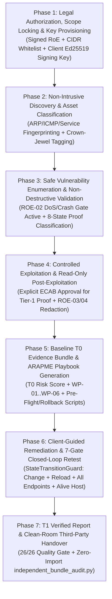

# Expedite Strike V3.6 — Client Environment Safe Engagement & Execution SOP

> [!IMPORTANT]
> **Objective**: Achieve the exact same **26/26 Quality-Gated, Cryptographically Signed, and Independently Verifiable** outcome in a live client production or staging environment while guaranteeing **zero unplanned downtime, zero destructive payload execution, and strict Rules-of-Engagement (RoE) compliance**.

---

## End-to-End 7-Phase Safe Client Engagement Workflow



---

## Phase 1 — Pre-Engagement Authorization, Scope Locking & Key Provisioning

Before a single packet is transmitted to a client network, configure the **RoE Safety Policy Engine (`XSTRIKE-V3-ROE-GUARD-01`)** and **EvidenceCore Key Custody**:

1. **Written Authorization & Signed Rules of Engagement (RoE)**:
   - Obtain signed authorization specifying the exact **CIDR ranges, FQDNs, excluded hosts** (e.g., legacy mainframes, medical/OT PLC controllers, active failover clusters), and **authorized maintenance windows**.
   - Share the **Assessor Sensor IP(s)** with the client's SOC/Blue Team so traffic is recognized as authorized testing rather than an unannounced breach, while keeping alerting active to measure SOC detection latency.
2. **Hard Scope Enforcement (`ROE-01`)**:
   - Configure the authorized target CIDRs and explicitly exclude the scanner sensor IP and out-of-scope subnets in [`build_xstrike_v3_architecture_and_roe_attestation`](file:///d:/XPedite-strike/cyber_range/services/evidence_intelligence.py#L5610-L5655) and the scanner target configuration.
   - Any IP outside the allowlist is dropped before socket creation.
3. **Dedicated Per-Client Cryptographic Signing Key (`EvidenceCore V3.6`)**:
   - Generate a client-engagement-specific Ed25519 signing key wrapped in a `PKCS#8` `AES-256-CBC` encrypted envelope via [`KeyCustodyAndEnvelopeProvider`](file:///d:/XPedite-strike/cyber_range/services/autonomous_remediation_engine.py#L100-L202) (or bind to enterprise AWS KMS / HashiCorp Vault / PKCS#11 HSM).
   - Export and hand the client CISO the **32-byte Public Key (`ed25519_pub.pem`)** and its **SHA-256 Fingerprint** at kickoff so the client can independently verify all deliverables at the end of the engagement.

---

## Phase 2 — Rate-Limited Discovery & Asset Criticality Reconciliation

1. **Controlled Network & Service Discovery**:
   - Run discovery with production-safe rate limits (`nmap -sV -T3 --max-rate 300`) rather than aggressive flood scanning (`-T5`).
   - XStrike's [`reconcile_assets_and_scope`](file:///d:/XPedite-strike/cyber_range/services/evidence_intelligence.py#L5079-L5172) automatically separates:
     - **`RESPONSIVE_ASSESSED`**: Hosts with reachable TCP/UDP services.
     - **`UNRESPONSIVE_NO_OPEN_PORTS`**: Hosts alive at L2/ARP/ICMP where host firewalls drop all TCP probes (classified as `TESTED_ROUTES_BLOCKED_BY_CONTROL`, $W_{\text{exec}} = 0.00$).
2. **Client Asset Criticality Alignment (`AC-05`)**:
   - Review the output of [`classify_host_asset`](file:///d:/XPedite-strike/cyber_range/services/evidence_intelligence.py#L4970-L5048) with the client infrastructure lead to confirm which hosts are **Crown-Jewel (`CROWN_JEWEL`, weight `1.5`)**, **High-Value (`HIGH_VALUE`, weight `1.25`)**, **Infrastructure (`1.2`)**, or **Standard (`1.0`)**.

---

## Phase 3 — Safe Vulnerability Enumeration & Non-Destructive Validation (`ROE-02`)

In a client environment, **Safety Control `ROE-02` (Exploit Allowlist & DoS Prohibition Gate)** is mandatory and active by default:

| Vulnerability Class | Safe Client Procedure in XStrike V3.6 | Resulting Proof & MITRE State |
| :--- | :--- | :--- |
| **Crash / Ring-0 / Memory Race Exploits** (e.g., `MS17-010` EternalBlue, `CVE-2016-5195` Dirty COW, Heap Overflows) | **NEVER execute ring-0 shellcode or kernel memory overwrites** on production hosts. Validate non-destructively via protocol dialect/banner inspection or authenticated package audit (`dpkg -l`, `rpm -qa`, `systeminfo`). | Held at `OBSERVED` or `VALIDATED` (`PRECONDITION_DISCOVERED`); never inflated to `CONFIRMED_COMPROMISE`. |
| **Denial-of-Service Checks** (e.g., Slowloris `CVE-2007-6750`, Apache Byte-Range `CVE-2011-3192`, DNS Amplification) | Execute single-socket timeout or header differential checks only. **Connection-exhaustion floods are hard-blocked by `ROE-02`**. | Classified as `OBSERVED` (`SCANNER_HEURISTIC_UNVERIFIED_BY_SAFETY_ROE`). |
| **Web / API Injection & SSRF (`TrePath v7.0`)** | Use deterministic read-only sleep/boolean/error differentials or loopback metadata probes. **Zero `DROP`, `UPDATE`, or destructive `POST` payloads**. | Classified as `VALIDATED` (`TECHNIQUE_VALIDATED`). |
| **Web Login Forms** (e.g., Admin portals, `/login.php`) | Rate-limited check against approved test/default accounts without triggering AD/IdP mass account lockouts. If only a form heuristic matches without a session cookie, [`build_f07_proof_classification_audit`](file:///d:/XPedite-strike/cyber_range/services/autonomous_remediation_engine.py#L243-L286) holds it at `VALIDATED`. | `VALIDATED` unless a real post-auth session token + DOM proof is captured. |

---

## Phase 4 — Controlled Proof-of-Concept & Read-Only Post-Exploitation (`ROE-03` & `ROE-04`)

When a critical vulnerability (e.g., an exposed bind shell, RCE service, or default database/SSH credential) is discovered and the client authorizes **`CONFIRMED_COMPROMISE`** or **`CONFIRMED_AUTH`** validation:

1. **Read-Only Post-Exploitation Command Whitelist (`ROE-04`)**:
   - The session collector executes **only** non-destructive identity and posture verification commands:
     - Linux/Unix: `id`, `whoami`, `uname -a`, `hostname -I`, `find / -perm -4000 -type f 2>/dev/null`, `cat /etc/exports`, `dpkg -l` / `rpm -qa`.
     - Windows: `whoami /all`, `hostname`, `ipconfig /all`, `systeminfo`, `netstat -ano`.
     - Databases: `SELECT current_user, version(), inet_server_addr();` (read-only catalog check).
2. **Automatic Secret Redaction (`ROE-03`)**:
   - Never exfiltrate bulk customer PII or password databases.
   - If hash proof is required (e.g., `head -n 5 /etc/shadow`), [`sanitize_evidence`](file:///d:/XPedite-strike/cyber_range/services/evidence_intelligence.py#L1400-L1435) automatically masks secret hashes with `[REDACTED_SHADOW_HASH]` before storing in SQLite or rendering to PDF, while binding the transcript with `SHA-256` and `HMAC-SHA256`.
3. **Cross-Host Lateral Movement Validation**:
   - Validate lateral pivot preconditions (e.g., SSH keys, connection strings, NFS exports, firewall reachability across VLANs) using [`build_attack_graph_intelligence`](file:///d:/XPedite-strike/cyber_range/services/evidence_intelligence.py#L3150-L3225).
   - Clearly separate **`LATERAL_MOVEMENT_SUCCEEDED`** (where cross-zone hop was authorized and proven), **`LATERAL_PRECONDITION_VALIDATED_NOT_EXECUTED`** (where pivot credentials/trust exist but cross-host login was withheld by RoE), and **`TESTED_ROUTES_BLOCKED_BY_CONTROL`** ($W_{\text{exec}} = 0.00$).

---

## Phase 5 — Baseline ($T_0$) Snapshot & Autonomous Work Package Synthesis (`ARAPME`)

Once active testing finishes, run the XStrike intelligence pipeline:

1. **Deduplication & Root-Cause Attribution**:
   - [`correlate_and_enrich_findings`](file:///d:/XPedite-strike/cyber_range/services/evidence_intelligence.py#L6800-L7500) deduplicates raw scanner noise into canonical security findings (`F-01..F-NN`) and isolated reconnaissance items (`R-01..R-MM`), computing the **Measured Baseline ($T_0$) Calibrated Risk Score**.
2. **Remediation Work Package Delivery (`WP-01`..`WP-06`)**:
   - Deliver the generated **Remediation Work Packages** from [`AutonomousRemediationAndAttackPathEngine`](file:///d:/XPedite-strike/cyber_range/services/autonomous_remediation_engine.py#L288-L558) to the client's engineering teams.
   - Each Work Package includes:
     - **Pre-Flight Check Command** (`preflight_check_cmd`) to verify service state before touching configs.
     - **Backup & Rollback Script** (`rollback_cmd`) to restore exact prior state in <60 seconds if an issue occurs.
     - **Remediation Playbook** (`ansible_or_shell_playbook`) with `SHA-256` integrity hash.
     - **Post-Execution Verification Command** (`post_execution_verify_cmd`).

---

## Phase 6 — Client-Controlled Remediation & 7-Gate Closed-Loop Retest ($T_1$)

> [!WARNING]
> **Critical Safety Rule for Client Environments**: Never run automated service-stopping or firewall-dropping playbooks blindly on live client production servers without an approved Change Ticket (`CHG-YYYY-NNNN`) and client operator sign-off.

1. **Change Execution Mode**:
   - **Mode A (Client-Executed — Recommended for Production)**: Client engineers execute the `WP-01..WP-06` playbooks during their approved Change Advisory Board (CAB/ECAB) maintenance window.
   - **Mode B (Supervised Autonomous Execution — Staging/Approved Windows)**: XStrike dispatches the playbook only after pre-flight checks pass and a VM/config snapshot is confirmed.
2. **7-Gate Verification via [`StateTransitionGuard.verify_closure_gate`](file:///d:/XPedite-strike/cyber_range/services/autonomous_remediation_engine.py#L51-L97)**:
   - For each finding the client claims is fixed, XStrike runs a targeted retest and enforces **all 7 closure gates**:
     1. `change_applied == True`
     2. `service_reloaded == True` (catches un-reloaded daemons like `RETEST-05-FAILED`)
     3. `control_effective == "EFFECTIVE_ALL_ENDPOINTS"` (catches partial vhost fixes like `RETEST-04-PARTIAL`)
     4. `host_online_confirmed == True` via **Negative-Control Alive Check** (prevents an offline/powered-down server like `RETEST-03-NEG-CTRL` from being falsely marked fixed)
     5. Valid `before_sha256`
     6. Valid `after_sha256`
     7. Valid `negative_control_sha256`
3. **Strict 3-State Separation (`AC-26`)**:
   - Only findings passing all 7 gates transition to **`REMEDIATION_VERIFIED`**, sever their corresponding AttackGraph chains at $T_1$, and reduce the **Measured Post-Retest ($T_1$) Risk Score**.
   - Unexecuted work packages remain in **Isolated What-If Simulations (`SIM-T2`, `SIM-T3`, `SIM-30D`)** with `mutates_measured_posture = False`.

---

## Phase 7 — Pre-Release Quality Gate (`26/26`) & Clean-Room Client Handover

Before delivering the final report to the client, execute the three-command certification checklist:

```powershell
# 1. Run the 26-Rule Quality Gate & 30 Regression Tests (AC-01..AC-26, REG-01..REG-30)
python -m unittest cyber_range.services.test_xstrike_v2_acceptance -v

# 2. Run the Standalone Database-Free Verifier (9/9 CERT-01..CERT-09 Tamper & Governance Self-Tests)
python -m cyber_range.services.verify_manifest --bundle cyber_range/reports/XStrike_Evidence_Bundle.json --pubkey cyber_range/reports/ed25519_pub.pem

# 3. Run the Zero-XStrike-Import Clean-Room Auditor
python scripts/independent_bundle_audit.py --bundle cyber_range/reports/XStrike_Evidence_Bundle.json --pubkey cyber_range/reports/ed25519_pub.pem --out cyber_range/reports/XStrike_Independent_Reproduction_Audit.json
```

### Final Client Deliverable Package
Hand over the following 6 files so the client's internal audit or GRC team can independently verify every finding, retest, and signature without access to XStrike's database:
1. **`XStrike_Pentest_Report_Verified_v3.pdf`** — Executive & Technical Report (`26/26 Quality Gates Passed`).
2. **`XStrike_Evidence_Bundle.json`** — Complete standalone evidence & remediation bundle (`100%` SHA-256 + Merkle + Ed25519 signed).
3. **`ed25519_pub.pem`** — Public verification key matching the pre-engagement pinned SHA-256 fingerprint.
4. **`XStrike_SARIF_v210.json`** — OASIS SARIF v2.1.0 bundle for direct import into GitHub Advanced Security, Jira, or DefectDojo.
5. **`XStrike_Autonomous_Remediation_Attestation.json`** — Signed `WP-01..WP-06` playbooks, `StateTransitionGuard` ledger, and dual-signed key rotation attestation.
6. **`scripts/independent_bundle_audit.py`** — Single-file, zero-dependency Python auditor (`stdlib` + `cryptography`) allowing the client to reproduce all hash and signature checks in 2 seconds.

---

## Appendix A — Operating the Expedite Strike Web Console Safely in a Client Environment


When scanning a live client environment using the **EXPEDITE STRIKE — Autonomous Pentest Engine** UI console (`/app/?standalone=1`), use the following **2-Pass Safe Console Procedure** across the three UI panels (`TARGET SCOPE`, `INTENSITY & MODULES`, and `LAUNCH / PDF / HTML`):

### 1. Panel 1: `TARGET SCOPE` (`Network` vs. `Web/API` + `Import`)
- **Use Explicit Host IPs First (Avoid Broad `/16` or `/24` Ranges on Pass 1)**:
  - Paste only the **written-authorized client IP addresses** (one per line, as shown in the screenshot: e.g., `192.168.195.139`, `192.168.195.140`) or use **`Import`** to load the signed scope CSV/TXT list.
  - **Exclude** sensitive/fragile appliances (legacy printers, medical/OT PLCs, active domain controller replication links) before clicking `LAUNCH ATTACK`.
- **Switch to `Web/API` Tab for Application-Only Scopes**:
  - When assessing a client web portal or REST API, select **`Web/API`** and enter the exact `https://app.client.com` base URLs so network-layer SMB/RPC probes are skipped.

### 2. Panel 2: `INTENSITY & MODULES` — Recommended 2-Pass Selection

| Engagement Pass | Intensity Dropdown | Modules to Check (`ON`) | Modules to Leave Unchecked (`OFF`) Until Approved | Why |
| :--- | :--- | :--- | :--- | :--- |
| **Pass 1: Safe Discovery & Non-Intrusive Posture Baseline** *(Default for Live Client Production)* | **`Standard (~5 min)`** (or `Light / Quick`) | `[x] Nmap`<br>`[x] ZAP`<br>`[x] Nuclei`<br>`[x] OWASP Top 10`<br>`[x] AegisProbe`<br>`[x] OpenVAS` *(if scheduled)* | `[ ] Cred Spray`<br>`[ ] Exploit Engine`<br>`[ ] PrivEsc`<br>`[ ] AD Scanner` *(unless AD in scope)* | Enumerates all open ports, banners, TLS/SSL flaws, missing headers, CVEs, and OWASP web weaknesses **with zero risk of account lockouts or shell openings**. |
| **Pass 2: Controlled Validation & Proof Capture** *(Authorized Maintenance Window / Staging)* | **`Standard (~5 min)`** | `[x] Exploit Engine`<br>`[x] PrivEsc`<br>`[x] AD Scanner`<br>`[x] Cred Spray` *(only if RoE allows default cred checks)* | Keep **`ABORT`** button ready for instant kill-switch (`ROE-05`) | Runs controlled proof verification on the specific high-value targets identified in Pass 1 while `ROE-02` blocks DoS/crash payloads (`Slowloris`, `Dirty COW`, `MS17-010` ring-0). |

> [!CAUTION]
> **Why `Cred Spray` Should Be Unchecked on Production Active Directory**: Checking `Cred Spray` against a live corporate domain controller or SSO endpoint with a strict lockout policy (e.g., 3–5 bad passwords = 30-minute lockout) can lock out shared service accounts. Only enable `Cred Spray` against isolated lab/staging hosts or when testing default vendor service accounts (`postgres`, `anonymous` FTP) approved in the RoE.

### 3. Panel 3: `8-Phase Pipeline` & Generating the `26/26` Certified Deliverable
1. **Monitor the 8-Phase Progress Bar & Live Terminal**:
   - Watch phases **`1. RECON` -> `2. VULN SCAN` -> `3. EXPLOIT` -> `4. PRIVESC` -> `5. OWASP` -> `6. POST-EX` -> `7. LATERAL` -> `8. REPORT`** complete in the UI.
   - If the client SOC reports any latency spike on a target host, click the red **`ABORT`** button immediately (`ROE-05` kill-switch terminates all active worker threads while preserving already-collected evidence).
2. **Click `PDF` and `HTML` When Status Shows `COMPLETE`**:
   - Clicking **`PDF`** or **`HTML`** in the console automatically triggers the full **XStrike V3.6 Intelligence Pipeline** ([`generate_pdf_report`](file:///d:/XPedite-strike/cyber_range/services/pentest_report_pdf.py#L430-L2200) $\rightarrow$ [`correlate_and_enrich_findings`](file:///d:/XPedite-strike/cyber_range/services/evidence_intelligence.py#L6800-L7530) $\rightarrow$ [`AutonomousRemediationAndAttackPathEngine`](file:///d:/XPedite-strike/cyber_range/services/autonomous_remediation_engine.py#L288-L558)):
     - Deduplicates raw observations (e.g., `320 VULNS` in the counter card $\rightarrow$ `79` consolidated security findings + `22` recon items).
     - Separates **Measured Baseline ($T_0$)**, **Measured Post-Retest Verified ($T_1$)**, **7-Gate Verified Closures**, and **Isolated What-If Simulations (`SIM-T2`, `SIM-T3`)**.
     - Exports `XStrike_Evidence_Bundle.json`, `XStrike_Signed_Evidence_Manifest.json`, `ed25519_pub.pem`, `ed25519_EncryptedPrivateKeyInfo.pkcs8.pem`, `XStrike_SARIF_v210.json`, and `XStrike_Autonomous_Remediation_Attestation.json` into `cyber_range/reports/`.
     - Runs the **26-Rule Quality Gate (`AC-01`–`AC-26`)** and embeds the `26/26 PASSED` certification table directly into the downloaded PDF.

