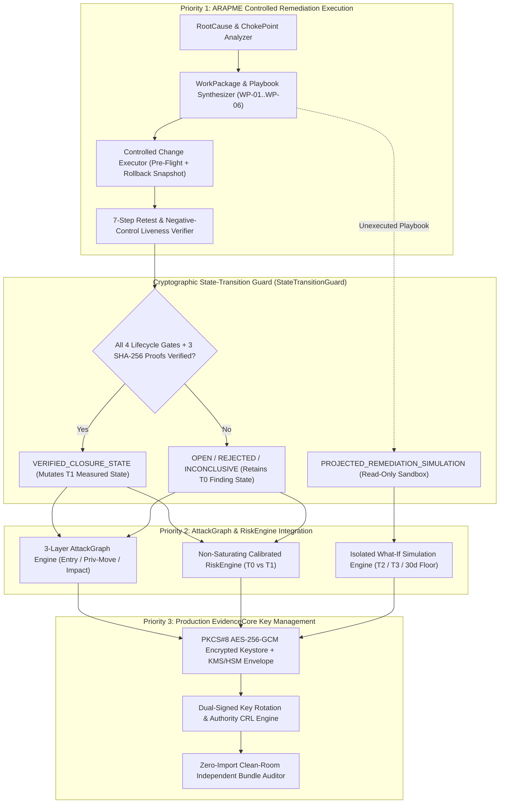

# XStrike V3.6 — Engineering & Developer Specification
**Autonomous Remediation Execution, Strictly Gated AttackGraph/Risk State Transitions & Production EvidenceCore Key Management**

> [!IMPORTANT]
> **Core Architectural Invariant of V3.6 (`StateTransitionGuard`)**:
> XStrike V3.6 enforces a hard, cryptographically gated boundary between three state classes across all database tables, APIs, AttackGraph calculations, RiskEngine scores, and PDF report sections:
> 1. **`MEASURED_SECURITY_STATE` (`T0_MEASURED_BASELINE`, `T1_MEASURED_POST_RETEST_VERIFIED`)** — Backed by live network/host telemetry and signed SHA-256 transcripts.
> 2. **`VERIFIED_CLOSURE_STATE` (`REMEDIATION_VERIFIED`)** — Granted **only** when all 4 execution gates (`change_applied`, `service_reloaded`, `control_effective`, `host_online_confirmed`) and 3 cryptographic hashes (`before_sha256`, `after_sha256`, `negative_control_sha256`) pass verification. Only a `VERIFIED_CLOSURE_STATE` record can sever a live AttackGraph edge or reduce the measured `T1` Risk Index.
> 3. **`PROJECTED_REMEDIATION_SIMULATION` (`SIMULATED_T2_WP01`, `SIMULATED_T3_WP02_WP03`, `SLA_FORECAST_24H_7D_30D`)** — Computed in an isolated read-only sandbox (`mutates_measured_posture = False`). Projected simulations are structurally prohibited from modifying `T1` finding states, `T1` AttackGraph chains, or `T1` risk scores.

---

## 1. System Architecture & Module Map



### Module Inventory

| Module Path | Primary Classes / Functions | Responsibility |
| :--- | :--- | :--- |
| [`cyber_range/services/autonomous_remediation_engine.py`](file:///d:/XPedite-strike/cyber_range/services/autonomous_remediation_engine.py) | `StateTransitionGuard`, `ControlledRemediationExecutor`, `KeyCustodyAndEnvelopeProvider`, `AutonomousRemediationAndAttackPathEngine` | Enforces the 3-way separation between measured states, verified closures, and projected simulations; manages work packages `WP-01`..`WP-06`, change tickets, PKCS#8 encrypted key envelopes, and SQLite V3.6 persistence. |
| [`cyber_range/services/evidence_intelligence.py`](file:///d:/XPedite-strike/cyber_range/services/evidence_intelligence.py) | `correlate_and_enrich_findings()`, `build_attack_graph_intelligence()`, `compute_evidence_weighted_risk()`, `run_report_quality_gate()` | Integrates `StateTransitionGuard` into the 3-layer AttackGraph and RiskEngine, persists the 11-table SQLite snapshot, and runs the **26-Rule Quality Gate (`AC-01`..`AC-26`)**. |
| [`cyber_range/services/verify_manifest.py`](file:///d:/XPedite-strike/cyber_range/services/verify_manifest.py) | `verify_exported_bundle_standalone()` | Zero-DB standalone verifier executing the 9-test structured certification ledger (`CERT-01`..`CERT-09`) and signing-key operations audit log (`KEY-AUDIT-01`..`KEY-AUDIT-04`). |
| [`scripts/independent_bundle_audit.py`](file:///d:/XPedite-strike/scripts/independent_bundle_audit.py) | `run_clean_room_audit()` | External clean-room reproduction script (`0` `cyber_range.*` imports) verifying all SHA-256 digests, Merkle root, Ed25519 signature, PKCS#8 key envelope, `F-02` status, `F-07` proof audit, and state-separation invariants. |
| [`cyber_range/services/pentest_report_pdf.py`](file:///d:/XPedite-strike/cyber_range/services/pentest_report_pdf.py) | `generate_pdf_report()`, `generate_html_report()` | Renders separated tables for **Measured Security Posture (`T0`, `T1`)**, **Verified Closure Ledger (`RETEST-01`..`RETEST-06`)**, and **Isolated What-If Remediation Simulations (`SIM-T2`, `SIM-T3`, `SLA-30D`)**. |

---

## 2. Priority 1 Specification — `ARAPME` Controlled Remediation Execution & State Separation

### 2.1 Strict Three-Class State Taxonomy (`StateTransitionGuard`)

Every posture record, finding transition, and risk snapshot in XStrike V3.6 must carry an explicit `state_class` enum value from the following disjoint set:

| `state_class` Enum | Allowed Sub-States | Cryptographic & Operational Gate | Permitted to Mutate Live `T1` AttackGraph & `T1` Risk Score? |
| :--- | :--- | :--- | :--- |
| **`MEASURED_SECURITY_STATE`** | `T0_MEASURED_BASELINE`, `T1_MEASURED_POST_RETEST_VERIFIED` | Must be computed directly from live assessment observations (`T0`) or `T0` minus `VERIFIED_CLOSURE_STATE` findings (`T1`). | **Yes (Defines Measured Posture)** |
| **`VERIFIED_CLOSURE_STATE`** | `REMEDIATION_VERIFIED` (`RETEST-01` `F-01`, `RETEST-02` `F-64`/`F-57`) | Requires `StateTransitionGuard.verify_closure_gate(retest_record) == True`:<br>1. `change_applied is True`<br>2. `service_reloaded is True`<br>3. `control_effective == "EFFECTIVE_ALL_ENDPOINTS"`<br>4. `host_online_confirmed is True`<br>5. `sha256(before_evidence) == before_sha256`<br>6. `sha256(after_evidence) == after_sha256`<br>7. `sha256(negative_control_evidence) == negative_control_sha256` | **Yes (Only State Permitted to Close a Finding or Sever a Live Graph Edge)** |
| **`UNVERIFIED_OR_HELD_REMEDIATION_STATE`** | `REMEDIATION_INCONCLUSIVE` (`RETEST-03`), `PARTIALLY_REMEDIATED_NOT_CLOSED` (`RETEST-04`), `RETEST_FAILED_STILL_VULNERABLE` (`RETEST-05`), `STAGE_0_PENDING_ECAB_WINDOW` (`RETEST-06` `F-02`) | Any retest or staged change where one or more of the 7 closure gate conditions above is `False`. | **No (`0.0` pts risk reduction; finding retains `T0` proof state; graph edge remains active)** |
| **`PROJECTED_REMEDIATION_SIMULATION`** | `SIM_T2_POST_WP01`, `SIM_T3_POST_WP02_WP03`, `SIM_SLA_24H`, `SIM_SLA_7D`, `SIM_SLA_30D_FLOOR` | Computed in `StateTransitionGuard.run_isolated_simulation()` on a deep-copied finding list (`copy.deepcopy(security_findings)`). | **NEVER (`mutates_measured_posture = False`; isolated in `projected_remediation_simulations`)** |

### 2.2 Controlled Change Execution Workflow (6 Steps per Work Package)
1. **Pre-Flight Baseline & Syntax Gate**: Captures pre-change configuration checksum (`pre_change_config_sha256`) and runs syntax/dependency checks (`sshd -t`, `apache2ctl configtest`, `testparm -s`, `stat -c '%a %n'`).
2. **Rollback Artifact Creation**: Writes timestamped `.bak` configuration snapshot and registers rollback command before any file or firewall mutation.
3. **Change Application (`CHANGE_APPLIED`)**: Executes idempotent shell/Ansible directives under change ticket `CHG-2026-1031-WP01`..`WP06`.
4. **Daemon Reload / Process Termination (`SERVICE_RELOADED`)**: Verifies PID recycling or socket closure (`fuser -k`, `systemctl restart`, `kill -HUP`).
5. **Primary + Sub-Endpoint Control Verification (`CONTROL_EFFECTIVE`)**: Probes the primary `host:port` and all consolidated sub-endpoints (`affected_endpoints`).
6. **Negative-Control Host Liveness Gate (`REMEDIATION_VERIFIED`)**: Verifies adjacent TCP service responsiveness and ICMP/ARP reachability on the same host before invoking `StateTransitionGuard.verify_closure_gate()`.

---

## 3. Priority 2 Specification — `AttackGraph` & `RiskEngine` Strictly Verified State Transitions

### 3.1 AttackGraph Edge & Chain State-Transition Algebra
For any AttackGraph chain $C = (e_1, e_2, \dots, e_k)$:
- At **$T_0$ (`T0_MEASURED_BASELINE`)**:
  $$\text{ChainState}_{T_0}(C) = \min_{e \in C} \text{EdgeState}_{T_0}(e)$$
- At **$T_1$ (`T1_MEASURED_POST_RETEST_VERIFIED`)**:
  An edge $e$ transitions to `MITIGATED_VERIFIED_CLOSED` at $T_1$ **if and only if** its backing finding $f(e)$ has passed `StateTransitionGuard.verify_closure_gate()`:
  $$\text{EdgeState}_{T_1}(e) = \begin{cases} \text{MITIGATED\_VERIFIED\_CLOSED} & \text{if } \text{Guard}(f(e)) = \text{VERIFIED\_CLOSURE\_STATE} \\ \text{EdgeState}_{T_0}(e) & \text{otherwise} \end{cases}$$
  - **Applied to `CHAIN-02` (`F-01` Ingreslock `:1524`)**: `RETEST-01` passes all 7 guard checks $\implies$ Edge `S2:Initial Access (F-01)` transitions to `MITIGATED_VERIFIED_CLOSED` $\implies$ `CHAIN-02` transitions from `CONFIRMED_EXECUTED` at $T_0$ to **`MITIGATED_VERIFIED_CLOSED_AT_T1`**.
  - **Applied to `CHAIN-01` (`F-02` vsFTPd `:21/:6200`)**: `RETEST-06` has `remediation_verified = False` (`STAGE_0_PENDING_ECAB_WINDOW`) $\implies$ `StateTransitionGuard` blocks transition $\implies$ `CHAIN-01` remains **`CONFIRMED_EXECUTED`** at $T_1$.

---

## 4. Priority 3 Specification — Production `EvidenceCore` Key Management & Independent Attestation

### 4.1 Encrypted Keystore Envelope & KMS/HSM Provider Architecture (`KeyCustodyAndEnvelopeProvider`)
To bridge the lab-pinned Ed25519 keystore with enterprise production key custody, [`KeyCustodyAndEnvelopeProvider`](file:///d:/XPedite-strike/cyber_range/services/autonomous_remediation_engine.py) implements:
1. **Authenticated PKCS#8 Encrypted Private Key Wrapping (`RFC 5958` / `BestAvailableEncryption`)**:
   - The Ed25519 private signing key is wrapped using `cryptography.hazmat.primitives.serialization.BestAvailableEncryption` (AES-256-CBC + PBKDF2/Scrypt HMAC-SHA256 key derivation from passphrase/KMS KEK) into `cyber_range/reports/ed25519_EncryptedPrivateKeyInfo.pkcs8.pem`.
   - Raw unencrypted private keys are never written to disk.
2. **Pluggable Custody Provider Interface (`CustodyProviderType`)**:
   - `ENCRYPTED_PKCS8_LOCAL_VAULT` (Active & Cryptographically Verified in Cyber Range: PBKDF2/Scrypt + AES-256 encrypted `ENCRYPTED PRIVATE KEY` PEM block).
   - `AWS_KMS_ENVELOPE_SIGNER` / `PKCS11_HSM_SIGNER` (Production Adapter Specification with `kms:Sign` / `CKM_EDDSA` binding).
3. **Dual-Signed Key Rotation Transition Manifest (`KEY-ROTATION-MANIFEST-V3.6`)**:
   - Demonstrates cryptographic key continuity by signing a key-transition descriptor with both the active Quarter key (`XSTRIKE-ED25519-ASYM-KEY-2026-Q4-01`) and the staged next-quarter successor key (`XSTRIKE-ED25519-ASYM-KEY-2027-Q1-01`), verifiable using both public keys without trusting internal database state.

---

## 5. V3.6 Database Schema (11-Table SQLite / PostgreSQL DDL)

In addition to the 7 V3.5 tables (`v2_assets`, `v2_evidence_provenance`, `v2_consolidated_findings`, `v2_attack_graph_edges`, `v2_remediation_retests`, `v2_risk_snapshots`, `v2_report_quality_audit`), V3.6 adds **4 dedicated ARAPME & Key-Governance tables**:

```sql
-- Table 8: Remediation Work Packages (WP-01 .. WP-06)
CREATE TABLE IF NOT EXISTS v36_remediation_work_packages (
    work_package_id TEXT,
    assessment_id TEXT,
    change_ticket_id TEXT,
    title TEXT,
    priority_sla TEXT,
    owner TEXT,
    coordination_state TEXT,
    finding_count INTEGER,
    finding_ids_json TEXT,
    preflight_check_cmd TEXT,
    playbook_sha256 TEXT,
    post_execution_verify_cmd TEXT,
    PRIMARY KEY (work_package_id, assessment_id)
);

-- Table 9: Controlled Change Executions & 7-Condition Closure Guard Audit
CREATE TABLE IF NOT EXISTS v36_change_executions (
    execution_id TEXT,
    assessment_id TEXT,
    finding_id TEXT,
    work_package_id TEXT,
    state_class TEXT,               -- VERIFIED_CLOSURE_STATE vs UNVERIFIED_OR_HELD_REMEDIATION_STATE
    change_applied INTEGER,
    service_reloaded INTEGER,
    control_effective TEXT,
    host_online_confirmed INTEGER,
    closure_guard_passed INTEGER,
    mutates_measured_t1_posture INTEGER,
    before_sha256 TEXT,
    after_sha256 TEXT,
    negative_control_sha256 TEXT,
    PRIMARY KEY (execution_id, assessment_id)
);

-- Table 10: Strictly Separated Posture & Simulation State Transitions
CREATE TABLE IF NOT EXISTS v36_state_transitions (
    transition_id TEXT,
    assessment_id TEXT,
    state_id TEXT,                  -- T0_MEASURED_BASELINE, T1_MEASURED_POST_RETEST_VERIFIED, SIM_T2_POST_WP01, etc.
    state_class TEXT,               -- MEASURED_SECURITY_STATE vs PROJECTED_REMEDIATION_SIMULATION
    mutates_measured_posture INTEGER,
    active_executed_chains_count INTEGER,
    active_root_vectors INTEGER,
    s_compromise REAL,
    s_exposure_calibrated REAL,
    s_asset REAL,
    s_reachability REAL,
    calibrated_score REAL,
    rating TEXT,
    PRIMARY KEY (transition_id, assessment_id)
);

-- Table 11: Production Keystore & Dual-Signed Rotation Audit Log
CREATE TABLE IF NOT EXISTS v36_keystore_audit_log (
    audit_id TEXT,
    assessment_id TEXT,
    key_id TEXT,
    custody_provider TEXT,
    operation TEXT,
    pkcs8_encrypted_verified INTEGER,
    pubkey_fingerprint_sha256 TEXT,
    timestamp_utc TEXT,
    status TEXT,
    PRIMARY KEY (audit_id, assessment_id)
);
```

---

## 6. V3.6 REST API Specification

| Endpoint | Method | Request Payload | Response & State-Guard Enforcement |
| :--- | :--- | :--- | :--- |
| `/api/v36/arapme/work-packages/synthesize` | `POST` | `{"assessment_id": "XSTRIKE-V3.6-..."}` | Returns `WP-01`..`WP-06` with `playbook_sha256`, `preflight_check_cmd`, and `chains_severed`. |
| `/api/v36/arapme/execute` | `POST` | `{"work_package_id": "WP-01", "change_ticket_id": "CHG-..."}` | Runs pre-flight check, creates `.bak` snapshot, executes playbook, and records `CHANGE_APPLIED` + `SERVICE_RELOADED`. |
| `/api/v36/arapme/verify-retest` | `POST` | `{"retest_id": "RETEST-01", "finding_id": "F-01"}` | Evaluates `StateTransitionGuard.verify_closure_gate()`. Only transitions finding to `REMEDIATION_VERIFIED` if all 7 checks pass. |
| `/api/v36/graph/recalculate` | `POST` | `{"mode": "MEASURED_T1" \| "SIMULATED_WHAT_IF"}` | If `MEASURED_T1`, applies only `VERIFIED_CLOSURE_STATE` records. If `SIMULATED_WHAT_IF`, runs in isolated deep-copy sandbox with `mutates_measured_posture: false`. |
| `/api/v36/evidence/independent-audit` | `GET` | `?bundle=XStrike_Evidence_Bundle.json` | Invokes clean-room verification (`0` internal DB queries) and returns `XStrike_Independent_Reproduction_Audit.json`. |

---

## 7. V3.6 Acceptance Criteria & Regression Tests (`AC-26` + `REG-27`..`REG-30`)

- **`AC-26` (`26th Quality Gate Rule`)**: Verifies that:
  1. `measured_security_states` (`T0`, `T1`), `verified_closure_ledger` (`RETEST-01`..`RETEST-06`), and `projected_remediation_simulations` (`SIM-T2`, `SIM-T3`, `SIM-30D`) are stored in disjoint structures with zero cross-contamination;
  2. Every `projected_remediation_simulations` entry has `state_class == "PROJECTED_REMEDIATION_SIMULATION"` and `mutates_measured_posture is False`;
  3. All 11 SQLite tables (including `v36_remediation_work_packages`, `v36_change_executions`, `v36_state_transitions`, `v36_keystore_audit_log`) are populated and verified;
  4. The `PKCS#8` encrypted signing-key envelope (`ed25519_EncryptedPrivateKeyInfo.pkcs8.pem`) and dual-signed key rotation transition manifest pass cryptographic verification.
- **`REG-27`**: `StateTransitionGuard` negative test — proves that passing an unverified, offline, partial, failed, or simulated record to `StateTransitionGuard.verify_closure_gate()` returns `False` and is blocked from mutating `T1` risk or AttackGraph edges.
- **`REG-28`**: AttackGraph edge-transition verification — proves `CHAIN-02` (`F-01`) is `MITIGATED_VERIFIED_CLOSED_AT_T1` while `CHAIN-01` (`F-02`) remains `CONFIRMED_EXECUTED` at `T1`.
- **`REG-29`**: Production Keystore `PKCS#8` encryption & dual-signed rotation manifest verification.
- **`REG-30`**: End-to-end 11-table SQLite persistence & Clean-Room Independent Auditor (`scripts/independent_bundle_audit.py`) verification of V3.6 state separation.
