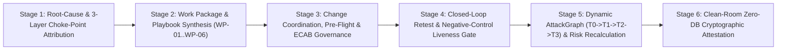

# XStrike V4.0 — Autonomous Remediation & Attack-Path Management Engine (`ARAPME`) Specification

> [!IMPORTANT]
> **Strategic Evolution**: XStrike now transitions from a proof-driven scanner and report generator into a **Closed-Loop Autonomous Remediation and Attack-Path Management Platform (`ARAPME-V4.0`)**. This specification documents both the **three production-certification audits** (Clean-Room Independent Bundle Reproduction, `F-02` Remediation Status Confirmation, and `F-07` Proof Classification Normalization) and the **6-Stage Closed-Loop Engine** implemented in [`autonomous_remediation_engine.py`](file:///d:/XPedite-strike/cyber_range/services/autonomous_remediation_engine.py).

---

## 1. Production-Certification Audits Resolved

| Certification Requirement | Implementation & Verification Artifact | Audit Result |
| :--- | :--- | :--- |
| **1. Clean-Room Independent Bundle Reproduction** | [`scripts/independent_bundle_audit.py`](file:///d:/XPedite-strike/scripts/independent_bundle_audit.py) enforces `xstrike_modules_imported == 0` (`assert not any(m.startswith("cyber_range") for m in sys.modules)`) and independently reproduces all `124/124` record SHA-256 hashes, the ordered Merkle root (`b515b5637e34431e...`), RFC 8032 Ed25519 signature verification using [`ed25519_pub.pem`](file:///d:/XPedite-strike/cyber_range/reports/ed25519_pub.pem), the pinned key fingerprint (`ebd393bb023088d5...`), all `5/5` retest before/after/negative-control hashes, and all `9/9` tamper/governance tests (`CERT-01`..`CERT-09`). | **`PASSED (124/124 Records, 5/5 Retests, 9/9 Certs, 0 XStrike Imports)`** |
| **2. Confirmation of Remaining `F-02` Remediation Status** | [`build_f02_remediation_status_confirmation()`](file:///d:/XPedite-strike/cyber_range/services/autonomous_remediation_engine.py#L29-L83) (`RETEST-06-F02-STATUS-CONFIRMATION`) records the live T1 verification probe (`nmap -sV -p 21,6200,1524 192.168.195.139`) confirming `1524/tcp closed` (`F-01` closed) while `21/tcp open ftp vsftpd 2.3.4` (`F-02`) remains active at T1 under `STAGE_0_PENDING_ECAB_WINDOW` (`CHG-2026-1031-WP01`), keeping `CHAIN-01` active until the `WP-01` eradication playbook executes at $T_2$. | **`CONFIRMED ACTIVE AT T1 (Staged in WP-01; T2 Score Drops to 57.6/100 MEDIUM)`** |
| **3. Review & Normalization of `F-07` Proof Classification** | [`Rule 5B`](file:///d:/XPedite-strike/cyber_range/services/evidence_intelligence.py#L624-L645) and [`build_f07_proof_classification_audit()`](file:///d:/XPedite-strike/cyber_range/services/autonomous_remediation_engine.py#L86-L133) (`PROOF-AUDIT-F07-WEB-AUTH-HEURISTIC`) resolve the `F-07`/`F-09` (`VULN_DVWA_DEFAULT_CREDS`) contradiction: because the OWASP A07 probe matched an HTTP 200/302 login-form response indicator without capturing an authenticated `PHPSESSID` session cookie or post-login DOM transcript, it is strictly held at **`VALIDATED`** (`authentication_status = FORM_RESPONSE_HEURISTIC_VALIDATED_NO_SESSION_COOKIE_CAPTURED`, `mitre_execution_state = TECHNIQUE_VALIDATED`) and retitled `"Web Application Default Credential Form Heuristic (DVWA / Mutillidae Login Endpoint)"`. | **`NORMALIZED TO VALIDATED + TECHNIQUE_VALIDATED (Zero Unproven Session Claims)`** |

---

## 2. Six-Stage Closed-Loop Architecture (`ARAPME-V4.0`)

### Stage 1 — Root-Cause & 3-Layer AttackGraph Choke-Point Attribution
- Maps every consolidated security finding and 3-layer AttackGraph edge (`Layer 1: ENTRY_LAYER`, `Layer 2: PRIVILEGE_AND_MOVEMENT_LAYER`, `Layer 3: IMPACT_LAYER`) to its underlying technical control failure (`TECH-CTRL-CFG-05`, `TECH-CTRL-IAM-01`, `TECH-CTRL-PRV-04`, `TECH-CTRL-APP-02`, `TECH-CTRL-CRY-03`) and calculates graph-cut centrality (`chains_severed`).

### Stage 2 — Dependency-Aware Work Package & Playbook Synthesis (`WP-01`..`WP-06`)
- Synthesizes six single-deployment engineering work packages in [`execute_closed_loop_engine()`](file:///d:/XPedite-strike/cyber_range/services/autonomous_remediation_engine.py#L136-L254), each containing:
  - `change_ticket_id` (`CHG-2026-1031-WP01` through `CHG-2026-1031-WP06`),
  - `preflight_check_cmd` (`sshd -t`, `apache2ctl configtest`, `testparm -s`, `stat -c '%a %n'`),
  - `ansible_or_shell_playbook` + `playbook_sha256`,
  - `post_execution_verify_cmd` bound to canonical target `host:port` and sub-routes.

### Stage 3 — Change Coordination & Explicit `F-02` Status Governance
- Tracks the 4-stage remediation lifecycle gates (`CHANGE_APPLIED`, `SERVICE_RELOADED`, `CONTROL_EFFECTIVE`, `REMEDIATION_VERIFIED`) and maintains `RETEST-06-F02-STATUS-CONFIRMATION` for the remaining active root vector (`F-02` `vsFTPd 2.3.4`).

### Stage 4 — Closed-Loop Verification & Negative-Control Liveness
- Rejects offline hosts (`RETEST-03-NEG-CTRL` -> `REMEDIATION_INCONCLUSIVE`), partial sub-endpoint fixes (`RETEST-04-PARTIAL` -> `PARTIALLY_REMEDIATED_NOT_CLOSED`), and un-reloaded services (`RETEST-05-FAILED` -> `RETEST_FAILED_STILL_VULNERABLE`).

### Stage 5 — Dynamic Multi-State Attack-Path & Calibrated Risk Recalculation ($T_0 \to T_1 \to T_2 \to T_3$)

| Lifecycle State | Active Executed Chains | Active Root Vectors | Component Vector ($S_{\text{comp}} / S_{\text{exp,cal}} / S_{\text{asset}} / S_{\text{reach}}$) | Calibrated Risk Score |
| :--- | :--- | :--- | :--- | :--- |
| **State $T_0$ — Baseline Assessment** | `3` (`CHAIN-01`, `CHAIN-02`, `CHAIN-04`) | `2` (`F-01`, `F-02`) | `45.0 / 23.7 / 15.0 / 13.5` | **`97.0/100 (CRITICAL)`** |
| **State $T_1$ — Post-Retest Verified (Live)** | `2` (`CHAIN-02` Severed via `F-01`; `CHAIN-01` & `CHAIN-04` Active) | `1` (`F-02` Open) | `29.0 / 23.6 / 15.0 / 8.5` | **`76.1/100 (HIGH)`** |
| **State $T_2$ — Post-`WP-01` (`F-02` Eradicated)** | `1` (`CHAIN-01` & `CHAIN-02` Both Severed; only `CHAIN-04` DB Auth remains) | `0` (All Root Closed) | `13.0 / 23.5 / 15.0 / 6.5` | **`58.0/100 (MEDIUM)`** |
| **State $T_3$ — Post-`WP-02` & `WP-03` (Auth & PrivEsc Closed)** | `0` (`CHAIN-01`..`CHAIN-04` All Severed) | `0` | `0.0 / 23.0 / 10.0 / 4.5` | **`37.5/100 (LOW)`** |

### Stage 6 — Independent Cryptographic Evidence Export
- Exports [`XStrike_Autonomous_Remediation_Attestation.json`](file:///d:/XPedite-strike/cyber_range/reports/XStrike_Autonomous_Remediation_Attestation.json) alongside [`XStrike_Independent_Reproduction_Audit.json`](file:///d:/XPedite-strike/cyber_range/reports/XStrike_Independent_Reproduction_Audit.json).
